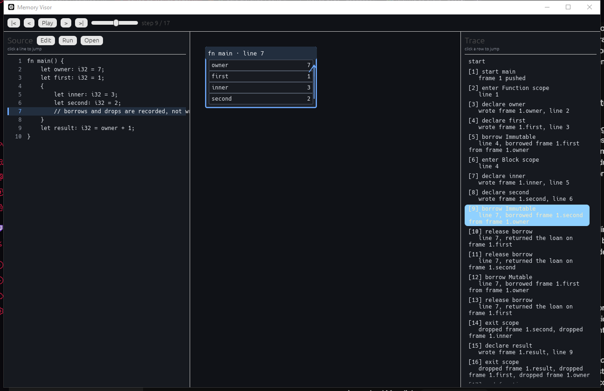

# Memory Visor


A visual data-flow and step-by-step execution viewer for a subset of Rust. It is
designed to model the mental picture of variables, scopes and mutations through
graphs of nodes that light up in real time: the running frame, the block it is
inside, and the branch a conditional jump took.



Run the desktop window with `cargo run --bin visor`; `cargo run` starts the
terminal walkthrough. The window opens on a hand-authored demo tape that covers
borrows and drops, then the **Source** panel switches to a live editor with
**Edit**: every keystroke is analysed and recorded, a failing construct is
reported on its line, and **Open** loads a `.rs` file from disk.

## What it supports today

The recorder (`src/edge/recorder.rs`) is an interpreter, not a text patcher. It
walks the supported subset and emits the same events the memory model already
knows how to replay, so every step in the window exists for a reason.

Supported:

- `fn name(parameters) -> Type { ... }` with parameters, `return` and calls
  between functions, including recursion (bounded by a depth limit).
- `let name: Type = value;` and `let mut name: Type = value;` with an explicit
  type and an initializer.
- Assignments and compound assignments: `=`, `+=`, `-=`, `*=`, `/=`, `%=`.
- Expressions with integer, float, boolean, character and string literals,
  variables, function calls, unary `-` and `!`, `+ - * / %`, comparison
  operators, `&&`, `||` and parentheses.
- `if` / `else` blocks and plain nested `{ ... }` blocks, with return values
  propagated out of a branch.
- `println!`, `print!`, `eprintln!`, `eprint!` and `dbg!`: recognised and
  skipped, because the canvas explains memory, not console output.
- A buffer without `fn main` is executed as the body of an implicit `main`, so a
  bare sequence of statements still records.

Not supported yet; a program that uses them stops with a clear error naming the
line instead of drawing a wrong trace:

- loops (`loop`, `while`, `for`) and `match`;
- structs, arrays and struct literals;
- method calls (`value.method()`);
- references and borrows (`&`, `&mut`) in the recorded source;
- `else if` chains (nest the condition inside `else { ... }` instead);
- shadowing: a second binding with the same name in the same frame;
- more than one statement per line, and blocks that do not put
  `} else {` on the closing line.

The memory model itself (in `src/stages/apply.rs`) still understands ownership,
borrows and `Drop`; the hand-written lifecycle sample exercises those events.
The recorder currently produces only the subset above.

## Beyond this subset

The canvas does not know Rust: it paints `MemoryState`s and reads `TraceEvent`s.
The coupling sits one level up — `apply` and `render` resolve names and types
through `ProgramTree`, the Rust declaration catalog — so a second language needs
its own parser/recorder plus that catalog, not a rewrite of the window.

`DESIGN.md` §15 lists the four steps that turn this into a contract instead of a
coincidence: the function name inside `StartFunction`, a `ProgramModel` trait,
a versioned JSON trace (`visor --trace`), and a written event contract. The same
section records the other known limit: the timeline keeps one full snapshot per
event, so scrubbing is O(1) but a trace of tens of thousands of events needs
keyframes.

None of that is implemented yet, and this README does not promise it. Today the
recorder runs one language: the subset above.

## Architecture

The project is split into three layers that only talk through data, so the
interpreter and the drawing can grow independently.

### 1. Analysis layer

`src/stages/analyze.rs` scans the source into a `ProgramTree`: functions,
parameters, local declarations, return types and call sites. It is deliberately
shallow (one statement per line) and never guesses: a malformed header or an
unknown type fails with a line number. `ProgramTree` is also the only
Rust-shaped type the trace engine still reads; §15 explains how to remove that
dependency.

### 2. Trace layer

- `src/edge/recorder.rs` interprets the supported subset. Every statement
  becomes a `TraceEvent`: a function call pushes a frame, `let` becomes
  `DeclareVariable`, a mutation becomes `WriteMemory`, a block opens and closes
  a scope, a conditional becomes `ConditionalJump`.
- `src/stages/apply.rs` is the semantic engine. It validates each event against
  the current `MemoryState` and either applies it or rejects it with an incident
  pinned to the exact cell.
- `src/stages/replay.rs` builds the `Timeline`: one `MemoryState` per event, plus
  the effects and incidents of the step.
- `src/stages/execution.rs` adds `ExecutionStep`, a read-only view over the
  timeline and the events. It answers the three questions the canvas asks:
  which node is active (`active_node`, resolved to a frame and a scope), which
  source line is running, and where a `ConditionalJump` sent the flow
  (`FlowEdge { from_line, to_line, outcome }`).
- `src/edge/player.rs` owns time: play, pause, next, previous and the tick
  accumulator used by the toolbar.

### 3. Visual layer

- `src/stages/layout.rs` computes pure geometry: frame boxes, heap object boxes,
  scope bands, slots and reference connectors, with no `egui` types.
- `src/shell/render.rs` paints that geometry. A frame box is outlined in blue
  while it is the active node, the innermost open scope gets a brighter band,
  and the branch of a conditional jump is drawn as a chip next to the frame.
  Incidents always win over the active highlight, so a failure is never hidden.
- `src/edge/ui/` holds the panels and controls: the source view and editor
  (`code.rs`), the event list (`trace.rs`), the toolbar and the window itself
  (`app.rs`).

The CLI in `src/main.rs` reuses the same trace and layout stages to print the
memory state and the computed geometry as text, which keeps both consumers
honest about the same model.

## Build and run

```bash
cargo build --release
cargo test --all-targets
cargo run               # terminal walkthrough
cargo run --bin visor   # desktop window
```

The window starts on `LIFECYCLE_SOURCE` and runs the hand-authored
`lifecycle_trace()` from `src/edge/sample.rs`, which exercises borrows and
`Drop` events the recorder does not emit yet; editing the source switches to
`record()` and the live subset. The CLI uses `SAMPLE_SOURCE`, a hand-written
trace with structs and arrays, so both paths of the trace engine stay covered.

## Contributing

### Extending the interpreter

1. Add the construct to the analyzer only if the static tree needs to know it;
   otherwise keep it in the recorder.
2. Handle it in `src/edge/recorder.rs` and emit the model events that already
   exist. If no event describes it, add one in `src/model/events.rs` and teach
   `src/stages/apply.rs` how to apply or reject it.
3. If it is unsupported, return a `RecordError` with the source line. Silence is
   a bug: the window must never pretend a statement ran.
4. Add a test in the recorder module that checks the resulting memory through
   `build_timeline`, and one in `src/stages/execution.rs` when the construct
   affects the active node or the flow.

### Extending the graphical nodes

1. Compute the geometry in `src/stages/layout.rs`; keep `egui` out of it.
2. Paint it in `src/shell/render.rs`. Use the existing `Palette` roles
   (`effect_*` for a step's effect, `code_active_*` for the cursor,
   `alert_*` for incidents) so the visual language stays consistent.
3. If a new kind of node can be active, extend `ExecutionNode` in
   `src/stages/execution.rs` and resolve it in `ExecutionStep`.
4. Add a layout test for the geometry and, when possible, a pure test for the
   colour precedence in `render.rs`.

### Adding another language

Start with `DESIGN.md` §15. The target contract is a `TraceEvent` stream plus a
`ProgramModel` catalog; until that trait exists, `apply` and `render` still need
`ProgramTree`. Keep language-specific parsing in its own front-end and do not
add language branches to the renderer.

### Before opening a pull request

```bash
cargo fmt --check
cargo test --all-targets
cargo clippy --all-targets -- -D warnings
```

The UI text lives in `src/shell/theme.rs`; keep it in English, and update
`DESIGN.md` when the architecture or the supported subset changes.

## License

Released under the MIT License. See [LICENSE](LICENSE).
